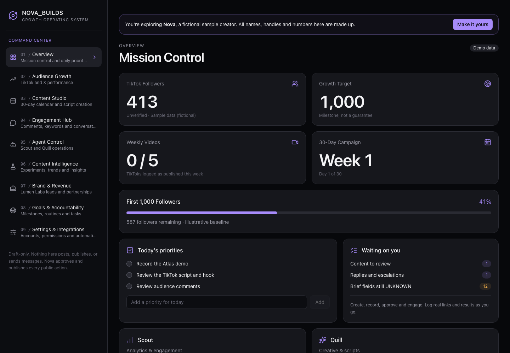
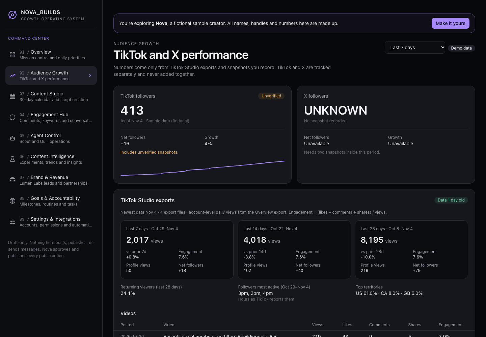

# Growth OS

A draft-only growth dashboard for creators on TikTok and X. Plan a 30-day content calendar, draft replies to comments, track real analytics from platform exports, and coordinate two AI agents: an analyst and a creative. Nothing in the app posts, publishes or sends. You approve and publish everything yourself.



## Try it

```
git clone https://github.com/daylorza/growth-os-app.git
cd growth-os-app/app
pnpm install
pnpm dev
```

Open http://localhost:5173. The app starts on **Nova**, a fictional sample creator with generated data. Choose **Make it yours** to swap the sample for your own empty workspace: your name, brand, agent names and handles. Your data stays in your browser.

Requires Node 22.18+ and [pnpm](https://pnpm.io). Without an endpoint the dashboard runs in local mode: data stays in your browser.

## What's inside

| Module | What it does |
|---|---|
| Overview | Followers, growth target, weekly cadence, campaign week, today's priorities, what's waiting on you |
| Audience Growth | TikTok and X follower history, 7/14/28-day views and engagement, audience signals, per-video table |
| Content Studio | 30-day calendar and creative briefs: three hooks, script, visuals, caption, CTA, native X version |
| Engagement Hub | Comment queue with categories, keyword campaigns and reply drafts that warn on prices, DM promises and repeats |
| Agent Control | Copyable system prompts for the analyst and creative agents, handoff chain, weekly loop, handoff log |
| Content Intelligence | Content mix vs targets, experiment log, weekly audience report, auto-drafted weekly report |
| Brand & Revenue | Lead pipeline. Revenue only counts with evidence |
| Goals & Accountability | 30-day plan, morning and evening check-ins, tasks with "smallest next action" for anything overdue |
| Settings & Integrations | Workspace profile, account connectors, approved brief, draft-only permissions, backup and restore |



## Principles

- **Draft-only.** Approval gates are built into the flow. A post can't be logged as published without your approval and a live URL. Sensitive comments can only be escalated, never auto-answered. Keyword campaigns stay off until there's a real resource to deliver.
- **No invented numbers.** Unknown values stay `UNKNOWN`. Metrics show "Unavailable" rather than guessing. TikTok views and X impressions are never added together.
- **Private by default.** With no endpoint configured, everything lives in your browser's local storage. With the optional endpoint (below), one authenticated server you host is the single source of truth for you and your agents. No tracking, no third-party accounts.

## Connect your accounts

All connectors are read-only. Set them up in **Settings → Accounts and connectors**.

- **Export files (works today for TikTok).** Download the Overview, Content, Viewers and Followers CSVs from TikTok Studio and import them. The parser fills in the year TikTok leaves out of its dates, takes post years from the video ID, and drops the occasional "0 followers" glitch day.
- **X, Instagram, YouTube, LinkedIn.** Connector slots are in place. Each parser is built from a real sample export, so the format is never guessed.
- **OAuth "Connect" buttons.** The client side is ready. Set `NEXT_PUBLIC_CONNECTOR_SERVER` to a server that implements the contract in [`app/src/lib/oauth.ts`](app/src/lib/oauth.ts). The server runs OAuth and keeps tokens; the browser only receives read-only, normalised data.

## Your own workspace on disk

For a permanent personal setup, create a `private/` folder at the repo root. It's gitignored.

```
private/
  workspace.json              # your profile and starting data (Settings → Export backup)
  vault/tiktok/inbox/         # drop TikTok Studio exports here
  brand/MASTER_AGENT_PROMPT.md  # optional: your own agent system prompt
```

Then run `cd app && pnpm tiktok:ingest`. New exports are copied into an immutable `raw/` folder with SHA-256 receipts, and the app's snapshot is regenerated. Re-running skips files it has already seen.

A test fails if any tracked file contains a name or handle from `private/workspace.json`. Private files are read by the Next.js server per request (local mode only) and are never bundled into a build. `GROWTH_OS_IGNORE_PRIVATE=1` previews the public sample even when `private/` exists.

## Central endpoint (one source of truth for you and your agents)

Without it, the dashboard, the creative agent and the analyst agent share nothing, and you copy text between them. The endpoint fixes that: everyone reads and writes the same store over one authenticated REST API. Agents never talk to each other directly; they talk through the endpoint, and the endpoint wakes them.

```
browser ──Basic auth──▶ Next.js dashboard :8766 ──(same header)──▶ NestJS API 127.0.0.1:8767 ──▶ MongoDB 127.0.0.1:27017
analyst agent  ──analyst key──▶ :8766/api/*  ◀── webhook (brief_created, daily_audit, post_published, measure_request, x_refresh)
creative agent ──creative key─▶ :8766/api/*      reads handoffs (analysis_created, experiment_logged, approval_given)
scheduler (systemd timers) ──worker key──▶ /api/dispatch/*   (no LLM call, no platform call)
```

- **Draft-only, enforced on the server.** No route posts, publishes, replies, likes, follows or messages anywhere, and there are no platform write calls in the codebase (`ci/no-platform-writes.sh` fails CI otherwise). Agents write drafts; only the creator approves, schedules, kills or logs something as published (with approval and a live URL). Revenue needs evidence.
- **Auth on every call.** `GET /health` is the only public route and returns no data. The creator uses HTTP Basic; each role has its own bearer key. Every write records who wrote it, when and from where (`_meta`), and an append-only audit log keeps the history.
- **Collection ownership.** A write to another agent's collection returns 403 (`packages/contracts/src/ownership.ts`):

  | Collection | Writes |
  |---|---|
  | `audience_snapshots`, `engagement_queue`, `experiments`, `reports`, `leads` | analyst, creator |
  | `briefs`, `hooks`, `scripts`, `captions` | creative, creator |
  | `handoffs` | everyone, only as themselves; only the recipient acknowledges |
  | `content_items` | everyone creates; the API owns ids and status rules |
  | profile, brief, settings, keywords, check-ins, migrations | creator |

- **No invented numbers.** Metrics are `number | "UNKNOWN"`, never 0 as a stand-in. TikTok and X are never added together: every audience query takes exactly one platform.

### How the agents talk (the handoff log)

A handoff is `{ id, contentItemId, from, to, type: analysis|brief|result|question|approval, body, refs[], createdAt, acknowledgedAt?, acknowledgedBy? }`. Every handoff hangs off a content item (or `AUDIT-YYYY-MM-DD` for a daily audit). `GET /api/content-items/:id/handoffs` returns the thread in order; `POST /api/handoffs/:id/ack` marks it read by its recipient. Anything unread after 24h is flagged in the dashboard.

Shared memory is enforced: an analysis must cite the snapshots or experiments it used, and a brief must cite the analysis handoff it builds on (`sourceHandoffId`). No citation, no write.

The loop, with no human step between a brief and an analysis:

1. The creative agent writes a brief (`POST /api/briefs`) → the API logs a `brief` handoff and sends `brief_created` to the analyst.
2. The analyst writes an analysis handoff citing its data → `analysis_created` to the creative agent.
3. The creator approves in the dashboard → a creator handoff and `approval_given`.
4. The creator publishes it herself and logs the URL → `post_published`; the scheduler sends `measure_request` at 24h and 72h.
5. The analyst logs the result in the experiment log → `experiment_logged`. The creative agent reads it before the next brief.

`GET /api/content-items/:id/next-step` merges the latest analysis, result and brief, what waits on the creator, and one recommended action with its owner. The dashboard shows one card per item (Agent Control) with **Approve**, **Request changes** and **Kill**.

### Webhooks

Each event is stored in an outbox (`GET /api/events`, id `<event>:<handoffId>:<recipient>`, so a repeat never duplicates work) and POSTed to the recipient's webhook: `{ "event", "contentItemId", "handoffId", "from", "at" }`, with `Idempotency-Key: <handoffId>`, `Authorization: Bearer <listener key>`, 3 retries with exponential backoff. A recipient without a webhook (the creator, or an agent that reads the API) is recorded as `no_listener`. Configure with `ANALYST_WEBHOOK_URL` / `ANALYST_WEBHOOK_KEY` (and `CREATIVE_…`) on the host only.

Events: `daily_audit`, `brief_created`, `analysis_created`, `post_published`, `measure_request`, `x_refresh`, `experiment_logged`, `approval_given`.

### MCP server (analyst)

`POST /mcp` on the tailnet listener (`http://<host>:8766/mcp`) is a stateless streamable-HTTP MCP server. Only analyst keys can connect, and it is never exposed through Funnel. Send `Authorization: Bearer <analyst key>`, or use the separate connector key (`GROWTH_OS_CONNECTOR_KEY`), which is limited to `/mcp` and may also be sent as `?key=` on the tailnet listener (port 8766). The dashboard host moves `?key=` into the header and strips `key` from every forwarded URL, so it never reaches the API, its logs or an error message; on `/api/*` it is ignored. Rotate the connector key alone with `sudo ROTATE_CONNECTOR_KEY=1 … ./deploy/install-atlas.sh`. Each tool wraps an existing service with the same DTO, so ownership, draft-only and `UNKNOWN` rules match the REST API: `get_snapshots`, `get_experiments`, `get_openapi`, `create_snapshot` (one platform, unverified), `create_engagement_items` (always drafts), `create_experiment`, `create_report`, `create_lead`, `create_handoff` (an analysis needs refs), `list_inbox`, `ack_handoff`. No tool posts, replies, likes, follows or messages, and there is no tool for the creative collections.

```
npx @modelcontextprotocol/inspector --cli http://<host>:8766/mcp --transport http --header "Authorization: Bearer $KEY" --method tools/list
```

### Contract first

All DTOs live in `packages/contracts` (`@growth-os/contracts`): domain types, class-validator DTOs, the ownership table and the route table. The API's routes must equal that table (tested), and the OpenAPI spec is generated from it and committed (`packages/contracts/openapi.json`, `pnpm openapi`; the build fails if it is stale). It is served at `GET /api/openapi.json`. Agents read it as the source of truth for field names.

### API

All routes need a credential except `/health`. See `packages/contracts/openapi.json` for every field.

| Route | Purpose |
|---|---|
| `GET /health` | Status only |
| `GET /api/openapi.json`, `GET /api/session`, `GET /api/state` | Spec; who is calling; everything the dashboard needs |
| `GET/PUT /api/profile`, `GET/PATCH /api/brief` | Profile and approved brief (value, verified, source; blank stays `UNKNOWN`) |
| `GET /api/audience/latest?platform=tiktok\|x` | Latest snapshot for one platform |
| `GET/POST /api/audience/snapshots` (`?platform=&since=`), `DELETE …/:id` | Snapshots: platform, date, source, metrics |
| `GET/PUT /api/audience/tiktok-vault`, `GET /api/analytics/catalog\|series\|summary` | Export data; lakehouse-style analytics |
| `GET/POST /api/content`, `GET/PATCH/DELETE /api/content/:id` | Content items (dashboard) |
| `GET/POST /api/content-items`, `GET …/:id`, `…/:id/handoffs`, `…/:id/next-step`, `POST …/:id/decision` | Content items (agents), thread, next step, creator decision |
| `GET/POST /api/handoffs` (`?acknowledged=false&to=&contentItemId=`), `POST /api/handoffs/:id/ack` | The handoff log |
| `/api/briefs`, `/api/hooks`, `/api/scripts`, `/api/captions` | Creative drafts (GET, POST, PATCH, DELETE) |
| `/api/experiments`, `/api/engagement-queue`, `/api/leads` | Analyst data |
| `/api/keywords`, `/api/tasks`, `/api/checkins`, `/api/reports`, `/api/settings` | The dashboard's planning data |
| `GET /api/events`, `POST /api/dispatch/daily-audit`, `POST /api/dispatch/measure-requests`, `POST /api/dispatch/x-refresh` | Outbox; scheduler entry points |
| `POST /api/migrations/import`, `GET /api/migrations` | One-time import with a receipt |

Example, as an agent:

```
curl -H "Authorization: Bearer $KEY" "http://<host>:8766/api/handoffs?acknowledged=false&to=creative"
curl -H "Authorization: Bearer $KEY" -H 'content-type: application/json' \
  -d '{"contentItemId":"C-001","sourceHandoffId":"H-012","objective":"Show the demo"}' http://<host>:8766/api/briefs
```

### Run it locally

```
pnpm install                      # once, at the repo root (pnpm workspace: app, server, packages/contracts)
cd server && pnpm build
GROWTH_OS_USER=me GROWTH_OS_PASS=<16+ chars> pnpm start          # in-memory store without GROWTH_OS_MONGO_URL
cd app && GROWTH_OS_API=http://127.0.0.1:8767 pnpm dev           # dashboard now reads/writes the endpoint
```

See `server/.env.example` for every setting. Secrets live only in the server environment, never in git.

### Dashboard modes

The Next.js dashboard picks its data source on the server, per request:

- **Local** (no `GROWTH_OS_API`): browser local storage, as before.
- **Endpoint**: the API is the source of truth. Edits become REST calls; the page polls for agent writes. Pages require a creator login.
- **Offline**: the endpoint is unreachable, so the last cached copy is shown read-only. The cache is never written back.

Server Components fetch data from the API (the root layout loads the workspace; Audience Growth and Content Studio render endpoint summaries on the server). Client Components handle the interactive parts.

### One-time migration

```
cd server
GROWTH_OS_API=http://<host>:8766 GROWTH_OS_USER=... GROWTH_OS_PASS=... node scripts/migrate.mts
```

Pushes `private/workspace.json`, `private/endpoint-seed.json` (extra verified records such as baseline snapshots), the TikTok vault snapshot and the master prompt. Existing ids are never overwritten, so it is safe to re-run. The receipt (what was inserted and skipped, SHA-256 of the payload) is stored on the endpoint and in `private/migrations/`.

### Scheduler and analyst

- **Scheduler** (`server/src/worker/dispatch-worker.ts`): `dispatch-worker.js daily` sends today's `daily_audit` to the analyst (idempotent per day); `dispatch-worker.js measure` sends `measure_request` 24h and 72h after a post is published; `dispatch-worker.js x` sends `x_refresh` (one X snapshot request on today's audit thread, idempotent per 4-hour UTC window). It contains no LLM call and no platform call, and its key can only call `/api/dispatch/*`. The analyst agent reads X through its own connection when woken.
- **Schedule:** TBD, to be filled in by the analyst agent once approved. The timers ship disabled (placeholder 08:00 daily, measurement hourly, X refresh every 4h plus a random 0-2h delay). Enable only after approval: `sudo systemctl enable --now growth-os-dispatch-daily.timer growth-os-dispatch-measure.timer growth-os-dispatch-x.timer`.
- **Paste-in mode:** Agent Control → "Paste reply" stores the analyst's reply as an analysis handoff for `AUDIT-<date>`.
- **xAI fallback (disabled, step 2):** `server/src/worker/xai-fallback.ts` asks xAI's model to audit the X account with the built-in `x_search` tool (read-only) and writes the analysis, draft replies and an unverified snapshot as the analyst. It runs only if the creator adds `XAI_API_KEY` and `XAI_MODEL` to `growth-os-xai-fallback.service` on the host. xAI bills X search per fetched post.

### Deploy (tailnet host)

`deploy/install-atlas.sh` installs the systemd units (`growth-os-mongo`, `growth-os-api`, `growth-os-web`, the two scheduler services and timers, and the disabled xAI fallback). It is additive: no reverse-proxy changes, no other services touched. Secrets are generated on the host, stored only in the root-owned unit files (chmod 600), and never printed.

| Port | Bound to | Service |
|---|---|---|
| 8766 | tailnet IP only | Next.js dashboard, `/api` and `/mcp` pass-through |
| 8767 | 127.0.0.1 | NestJS API |
| 27017 | 127.0.0.1 | MongoDB 7.0 (Docker). 8.x does not start on Linux 6.19+/7.0 kernels yet (MongoDB SERVER-121912) |

Run only one live dashboard. Once the endpoint is live, a local preview is a cold backup and stays stopped.

### Stack mapping

Built in the same shape as a larger NestJS / Next.js / MongoDB product so it can move without a rewrite:

- **NestJS**: one module per domain (Profiles, Brief, Audience, Analytics, Content, Creative, Handoffs, Events, Experiments, Engagement, Leads, Workspace, State, OpenApi, Health), a global Auth guard driven by the contract route table, a global ValidationPipe with class-validator DTOs from `@growth-os/contracts`, services hold all logic. Express adapter underneath.
- **No CQRS.** Reads are GETs, writes are POST/PATCH/PUT/DELETE, services hold the rules. A command bus and separate read models would add moving parts without a benefit at this size. CQRS earns its keep when reads and writes scale or evolve independently (many read models, event sourcing, heavy fan-out).
- **MongoDB now, Postgres later.** Services only use the `Repository` interface in `server/src/db/store.ts` (list/get/insert/replace/remove by string `id`, equality filters). No `_id`, `ObjectId` or driver types reach the API. A Postgres repository is a new class behind the same interface; each collection maps to a table keyed by `id`.
- **Databricks (mirror).** `analytics_facts` is an append-only, long-format fact table: one row per observed metric, never updated; deleting a snapshot appends a `retract` row (later operation wins). `GET /api/analytics/catalog` publishes the Unity Catalog-style definition (`growth_os.audience.snapshot_facts`, typed columns, tags `contains_pii=false`, `platform_scoped=true`, `write_mode=append_only`, partitioned by platform). `series` and `summary` return their Spark SQL equivalent (`max_by`, `min_by`, `NOT EXISTS` retraction filter). Moving to Databricks means writing the same rows to a Delta table and running those queries.
- **AWS (mirror).** Stateless API and dashboard with environment-only config. Next.js → ECS Fargate or Amplify; NestJS → ECS Fargate behind an internal ALB; MongoDB → DocumentDB or MongoDB on EC2 (Postgres path → RDS); secrets → Secrets Manager; analyst worker → EventBridge Scheduler + ECS task or Lambda; tailnet-only access → private subnets with a VPN or Tailscale subnet router.
- **CI (GitHub and GitLab).** `.github/workflows/ci.yml` and `.gitlab-ci.yml` both run `ci/check.sh`: install, the no-platform-writes check, then lint, test and build for every workspace package.

## Development

```
pnpm install
pnpm test     # server: auth, draft-only, platforms never summed, UNKNOWN, privacy · app: formulas, guards, parsers, privacy guard, sync
pnpm lint
pnpm build
```

Dashboard: Next.js (App Router), React 19, TypeScript, Tailwind CSS v4. API: NestJS, MongoDB. Code layout and project rules are in [AGENTS.md](AGENTS.md). Changes go through a branch and a pull request.
